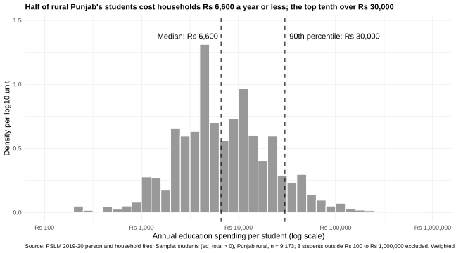
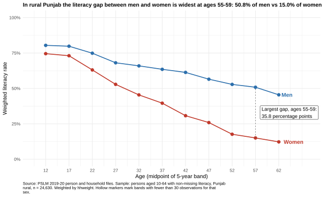
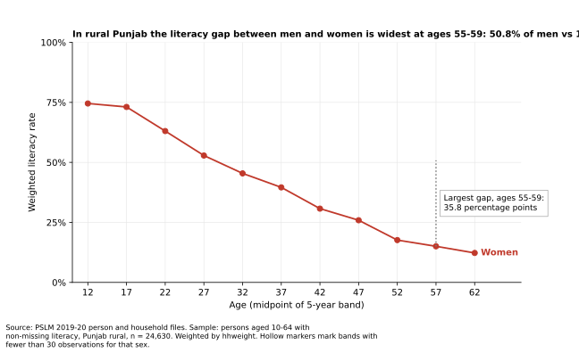

# ECO346-A1-FA24-BEDS-108
##`Name: Meerab Babar
**Variant 0: Punjab rural** (prov_code = 2, urban_rural = 1). Data: PSLM 2019-20.

## How to reproduce
Run the scripts in `scripts/` in order: 01 (data preparation, sourced by the others),
02 (default figure), 03 (distribution), 04 (literacy, R), 05 (literacy, Python).

## Q2. The distribution

- Students: 9,173
- Weighted median: Rs 6,600 | Unweighted median: Rs 7,000
- Weighted P10: Rs 2,000 | P90: Rs 30,000 | Ratio: 15.00
- Excluded outside Rs 100 to Rs 1,000,000: 3

Most students in rural Punjab cost households between Rs 2,000 and Rs 30,000 a year, a 15.00 times gap between the 10th and 90th percentiles. The histogram has two humps and a long right tail. The weighted median is Rs 6,600 and the unweighted one is Rs 7,000. They differ because higher-spending students come from households with slightly smaller weights (209 on average against 218), so weighting pulls the middle down.

## Q3. The relationship

| Band | Women (n) | Women literacy % | Men (n) | Men literacy % |
|---|---|---|---|---|
| 10-14 | 2133 | 74.5 | 2209 | 80.4 |
| 15-19 | 1758 | 73.1 | 1922 | 79.8 |
| 20-24 | 1574 | 63.1 | 1449 | 74.9 |
| 25-29 | 1386 | 52.9 | 1201 | 68.1 |
| 30-34 | 1176 | 45.4 | 1037 | 65.9 |
| 35-39 | 1194 | 39.6 | 1006 | 63.5 |
| 40-44 | 903 | 30.7 | 843 | 61.3 |
| 45-49 | 776 | 25.9 | 737 | 56.5 |
| 50-54 | 657 | 17.6 | 708 | 52.8 |
| 55-59 | 535 | 15.0 | 517 | 50.8 |
| 60-64 | 412 | 12.3 | 497 | 45.5 |

- Women 15-19: 73.1% | Men 15-19: 79.8%
- Women 55-59: 15.0% | Men 55-59: 50.8%
- Largest gap: ages 55-59 (35.8 points)

Literacy falls with age for both men and women in rural Punjab, but it falls much faster for women. At ages 15-19 the gap is small: 73.1% of women and 79.8% of men are literate. By ages 55-59 it is the widest, at 35.8 percentage points (15.0% of women against 50.8% of men). I read this as a cohort effect, since older women probably had much less access to schooling. The figure cannot tell us whether literacy changes as people age or only differs between birth cohorts, because it is one survey year.

## Q4. The makeover
Default figure: 

The default plots 24,630 dots at 0 or 1, so thousands of points sit on top of each other and no trend can be seen. This is overplotting. My first change was to replace the dots with conditional means: the weighted literacy rate for each age band and sex, which also respects the survey weights. Second, I put the rates on a common vertical scale from 0 to 100 percent, because position along a common scale is the most accurate channel for comparing values, and I used two colours so men and women can be compared directly. Third, I removed non-data ink: no legend (each line is labelled at its end), a light grid, and a title that states the finding. The default shows single years of age and every individual observation; my redesign hides both.
Redesign: the Q3 figure above (figures/literacy_by_age.svg).

## Q5. Second language (Python)

Women aged 15-19: 73.1% (R), 73.1% (Python).

A default that differed was the plot style. R’s theme_minimal shows light gridlines and no box, while matplotlib has no grid and a full frame. I turned the grid on, hid the top and right borders, and set the same axis limits (10 to 68, 0 to 100) so the two figures look alike. The band tables agree to one decimal place; for example, women aged 15-19 are 73.1% in both R and Python.